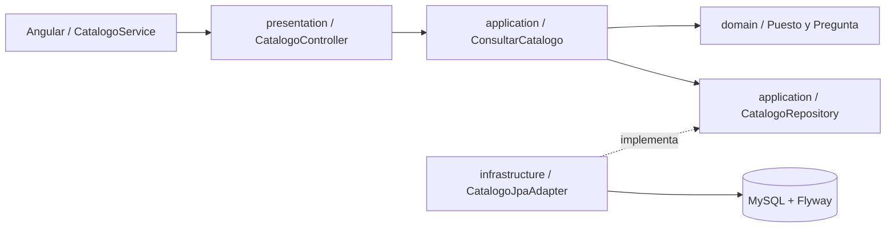

# Arquitectura del Incremento 1

Backend modular Spring Boot, Java 17, paquete `pe.utp.entrevistapro360`. Se adopta el contrato de la solicitud y el complemento de decisiones del 19/10/2026.

## Cuatro capas

| Capa | Responsabilidad | Componentes reales |
| --- | --- | --- |
| `presentation` | Transporte HTTP, DTO, validación de parámetros y errores JSON | `CatalogoController`, `PuestoResponse`, `PreguntaResponse`, `ApiError`, `GlobalExceptionHandler`, `SecurityExceptionHandler` |
| `application` | Coordinar la consulta y declarar los puertos independientes de frameworks | `ConsultarCatalogo`, `ConsultarCatalogoService`, `CatalogoRepository` |
| `domain` | Modelos puros y regla de las tres preguntas activas del mismo puesto, con órdenes 1, 2 y 3 | `Puesto`, `Pregunta`, `CatalogoInvalidoException` y los otros seis modelos canónicos |
| `infrastructure` | Implementar persistencia y componer/configurar la aplicación | `CatalogoJpaAdapter`, entidades/repositorios JPA, `ApplicationConfig`, `SecurityConfig`, Flyway |

Dominio y aplicación importan únicamente Java y sus propias capas permitidas. `LayerDependenciesTest` comprueba esta restricción. Los controladores reciben el puerto de entrada; no acceden a JPA. Los modelos del dominio no tienen anotaciones JPA ni Spring. `ApplicationConfig` compone el caso de uso con el puerto de salida. La configuración de seguridad recibe interfaces de Spring; la serialización de errores HTTP permanece en presentación.

## Primera consulta vertical

1. `CatalogoService` usa `ApiClient`, cuyo prefijo configurable por inyección es `/api/v1`.
2. El controlador transforma los modelos en DTO de respuesta.
3. El caso de uso solicita puestos activos o busca primero un puesto activo. Su ausencia produce 404.
4. El adaptador consulta JPA; las preguntas se filtran por puesto y actividad y se ordenan por `orden`.
5. El dominio verifica cantidad, pertenencia, actividad y órdenes. Un catálogo inconsistente devuelve 409; no se presenta una práctica incompleta como válida.
6. El caso de uso entrega las preguntas ordenadas. Angular muestra carga, resultado, ausencia de datos o error con reintento de consulta.

No hay preguntas aleatorias ni respuestas simuladas. El catálogo público permite explorar las tres preguntas. El bloqueo de avance durante una entrevista depende de sesiones/evaluaciones y queda pendiente.

## Persistencia y contratos

`V1__esquema_inicial.sql` crea las ocho tablas y 68 columnas solicitadas, con InnoDB y `utf8mb4_unicode_ci`, claves únicas y acciones referenciales exactas. `V2__catalogo_semilla.sql` carga tres puestos y nueve preguntas mediante búsqueda por nombre único, sin asumir IDs 1, 2 y 3. Flyway añade su tabla técnica `flyway_schema_history`, fuera del conteo de negocio.

Flyway es la autoridad del esquema: Hibernate usa `ddl-auto=validate`; no crea ni actualiza tablas. En este incremento solo `puestos` y `preguntas` tienen mapeo JPA y operaciones de lectura. Las otras seis entidades puras preparan vocabulario y tipos; sus operaciones y adaptadores de persistencia quedan pendientes. Los `DATETIME` se interpretarán como UTC y los decimales usan `BigDecimal`.

`CatalogoIntegrationTest` usa Flyway y JPA reales, sin mocks. `mvn test` utiliza H2 en modo MySQL con las mismas migraciones. El perfil de prueba `mysql`, junto con `TEST_DB_*`, ejecuta la misma consulta contra MySQL; `MySqlSchemaIntegrationTest` comprueba columnas, motor, collation, JSON y claves foráneas específicas del motor.

## Seguridad y alcance

Se permiten `/api/v1/puestos/**` y `/api/v1/auth/**`; las demás rutas requieren autenticación. No se implementan todavía endpoints de identidad, emisión/verificación de JWT ni sesiones autenticadas. Se deshabilitan el formulario y Basic; no existe un usuario de prueba automático. La política es stateless y CSRF está deshabilitado para la futura API con token en cabecera. Cuando se implemente autenticación se conectará la verificación JOSE y se probará autorización por propietario.

JOSE y AWS SDK S3 están declarados por solicitud, reservados para incrementos siguientes. No se crean clientes S3 ni se llaman APIs OpenAI. Los modelos STT/LLM se conservan como configuración solicitada; su disponibilidad no ha sido verificada. No se necesitan claves AWS/OpenAI para ejecutar el catálogo.

## Frontend

Angular standalone con carpetas por funcionalidad y rutas diferidas. `core/` contiene URL, cliente e interceptor; `shared/` contiene ambas cabeceras; `features/interviews/` implementa catálogo y consulta de preguntas. Las demás carpetas registran su alcance pendiente. La cabecera autenticada es reutilizable y no se muestra hasta disponer de identidad real.

`styles.css` aplica VIS-1.0: Arial, tamaños 28/24, 20/18, 16 y 14 px, variables de color, foco, enlace para saltar al contenido y adaptación móvil. El texto secundario se usa sobre blanco; sobre crema se usa texto oscuro. El proxy de desarrollo envía `/api/**` al backend; producción debe mantener ese mismo origen mediante un reverse proxy.
