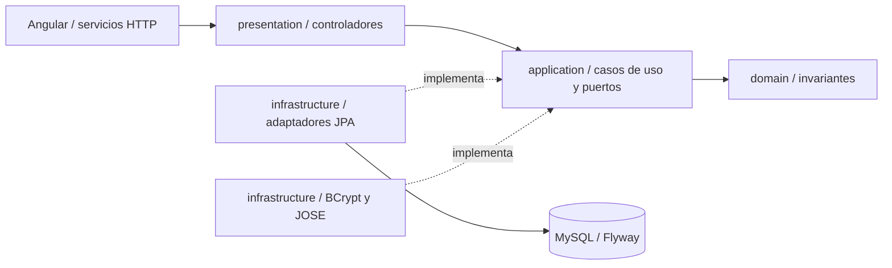

# Arquitectura — Incrementos 1 a 7

Backend modular Spring Boot 3.5.7/Java 17 y Angular 21.2.0 VIS-1.0. Catálogo, identidad, sesiones, captura privada y pipeline durable WAV/STT/MET/EVAL, con reintento único, cancelación D-02, resultado individual MCK09 y reproducción PA-04. Contratos en api-respuestas.md.

## Cuatro capas

| Capa | Responsabilidad | Componentes reales |
| --- | --- | --- |
| `presentation` | HTTP, DTO públicos, estructura de solicitudes y errores JSON | `CatalogoController`, `AuthController`, `PerfilController`, `SesionController`, `RespuestaController`, DTO, `GlobalExceptionHandler`, `SecurityExceptionHandler` |
| `application` | Casos de uso y puertos independientes de frameworks | Servicios de catálogo, registro, autenticación, perfil y sesiones; puertos de entrada/salida y modelos puros de lectura |
| `domain` | Modelos e invariantes puros | `Puesto`, `Pregunta`, `Usuario`, excepciones de validación y otros cinco modelos canónicos |
| `infrastructure` | JPA, BCrypt, JWT, seguridad y composición | Adaptadores/repositorios JPA, `BCryptPasswordHasher`, `JwtTokenProvider`, `JwtAuthenticationFilter`, configuraciones |

Dominio y aplicación solo importan Java y las capas internas permitidas. `LayerDependenciesTest` mantiene esta regla. Se inyecta `java.time.Clock` para obtener UTC sin depender de Spring en los casos de uso. Los controladores usan puertos de entrada y nunca acceden a JPA. La infraestructura implementa puertos y compone servicios; la serialización de errores permanece en presentación.

## Catálogo y persistencia

Se conservan los GET públicos del Incremento 1. El caso de uso busca un puesto activo y valida exactamente tres preguntas activas del mismo puesto, con órdenes 1, 2 y 3. Ausencia/inactividad produce 404; catálogo incompleto, 409. La semilla resuelve IDs por nombre único.

No se modifican V1/V2 ni se añaden V3+: ocho tablas y 68 columnas de negocio, InnoDB, `utf8mb4_unicode_ci`, JSON y acciones referenciales. `flyway_schema_history` es técnica adicional; Hibernate usa `ddl-auto=validate`. Hay ocho mapeos JPA activos, incluidos EvaluacionJpaEntity y sus 14 columnas canónicas de evaluaciones_star.

Las operaciones JPA son transaccionales en los adaptadores. Las pruebas MVC atraviesan seguridad, casos de uso y JPA reales, sin mocks del catálogo o identidad. H2 usa las mismas migraciones en modo MySQL; el perfil de pruebas `mysql` repite la integración y comprueba metadatos reales.

## Registro y acceso

`RegistrarUsuarioService` normaliza nombre/correo, valida contraseña, comprueba correo existente, calcula BCrypt y persiste. El dominio asigna POSTULANTE/ACTIVO, fecha UTC, actualización nula y resumen nulo. La restricción `uk_usuarios_email` resuelve también colisiones concurrentes: el adaptador la traduce a `EmailYaRegistradoException`, que produce 409. Se prueban el chequeo previo y una colisión SQL real.

`AutenticarUsuarioService` valida datos y compara el password exacto con BCrypt. Un usuario desconocido también realiza una comparación con hash ficticio. Contraseña incorrecta, usuario desconocido, cuenta inactiva o rol incompatible producen el mismo mensaje 401. No se promete bloqueo tras cinco intentos.

BCrypt usa costo 12 por defecto y en el perfil `prod`; las pruebas de integración usan costo 4. Una prueba separada verifica costo 12 y espacios. La contraseña nunca se recorta ni se normaliza silenciosamente. Se exigen al menos 12 puntos de código Unicode y como máximo 72 bytes UTF-8.

## JWT y autenticación por petición

`JwtTokenProvider` usa `NimbusJwtEncoder` con HS256. Incluye `iss=entrevista-pro-360`, `sub=id_usuario`, `rol=POSTULANTE`, `iat` y `exp=iat+1800`. `NimbusJwtDecoder` verifica firma/algoritmo; validadores comprueban issuer, timestamps, duración exacta y vencimiento sin tolerancia adicional.

En rutas privadas, `JwtAuthenticationFilter` toma el ID verificado y consulta la base en cada petición. Solo autentica si la cuenta existe, está ACTIVO y conserva rol POSTULANTE. Ausencia de token, firma/tiempo inválidos, cuenta eliminada/inactiva/bloqueada o rol incompatible producen 401 con `ApiError`. El contexto de seguridad contiene el ID; el perfil no usa IDs enviados por el cliente para seleccionar al propietario.

`JWT_SECRET` requiere al menos 32 bytes UTF-8. Si está vacío en local, se generan 32 bytes criptográficamente aleatorios por arranque, compartidos por encoder/decoder y nunca impresos. Reiniciar invalida esos tokens. El perfil `prod` impide la clave efímera y exige una variable válida. El fixture conocido de pruebas solo aparece en recursos de test.

La API es stateless, sin formulario de Spring, Basic ni usuario automático. CSRF está deshabilitado para la credencial explícita en Authorization, sin cookies de autenticación. Catálogo y `/auth/**` son públicos; el resto exige autenticación.

## Perfil y DTO

`GestionarPerfilService` consulta al propietario autenticado y construye un nuevo `Usuario` cambiando solo nombre, resumen y fecha de actualización. El adaptador modifica únicamente esas columnas. ID, correo, hash, rol, estado y fecha de registro se conservan.

Nombre: trim, 1..150. Correo: trim, minúsculas Locale.ROOT, formato válido y máximo 150. Resumen: trim, vacío a null, máximo 500 y texto plano. Jackson usa `SNAKE_CASE`, rechaza propiedades desconocidas y coerción de escalares. PATCH rechaza correo, rol, estado, hash, IDs y cualquier propiedad ajena al DTO. Las respuestas enumeran ocho propiedades públicas y nunca exponen el hash. Las fechas usan ISO 8601 con `Z` y DATETIME UTC con precisión de segundos.

Los errores mantienen `codigo`, `mensaje` y `errores_campo`. Los contratos HTTP se detallan en `api-catalogo.md`, `api-identidad.md` y `api-sesiones.md`. Los nombres de campos de Bean Validation también se convierten a snake_case, incluido `id_puesto`; se rechaza coerción de decimales a IDs enteros.

## Sesiones: unidad transaccional y bloqueos

`GestionarSesionService` implementa el puerto de entrada puro `GestionarSesion`; `SesionRepository` declara consultas y límites transaccionales con callbacks Java (`Supplier`/`Function`). La aplicación no importa anotaciones de Spring. `SesionJpaAdapter` ejecuta el callback dentro de una transacción Spring: el bloqueo vive hasta que termina toda la operación y se confirma el commit, sin liberarse entre comprobación e inserción.

Para crear, `conUsuarioBloqueado` usa READ_COMMITTED y su primera lectura es `UsuarioJpaRepository.findByIdForUpdate` con PESSIMISTIC_WRITE. Bajo esa exclusión consulta sesión INICIADA/EN_PROCESO, valida catálogo, crea con `LocalDateTime.now(clock).withNano(0)` y ejecuta `saveAndFlush`. Dos solicitudes para un mismo usuario se serializan; la segunda observa la sesión confirmada por la primera y recibe 409 con el ID vigente. No se usa un candado en memoria ni se añade una tabla/columna/índice.

Para cancelar, `findPropiaForUpdate` bloquea la sesión filtrando simultáneamente ID y propietario. El dominio cancela INICIADA/EN_PROCESO, conserva fechas si ya estaba CANCELADA y rechaza COMPLETADA. El promedio de CANCELADA es siempre null. Se conservan respuestas. Sesiones inexistentes y ajenas generan el mismo 404.

`VistaSesion`, `EstadoPreguntaSesion`, `ResumenSesionItem` y `ResumenSesionesUsuario` son modelos puros de lectura. El avance se calcula a partir de las respuestas persistidas: una etapa distinta de EVALUADO bloquea la siguiente pregunta. La consulta de resumen carga las respuestas por colección de sesiones y reutiliza catálogos por puesto; ordena items por inicio/ID y selecciona la última completada por fecha final/ID. El frontend presenta el promedio almacenado sin volver a calcularlo.

Una prueba usa dos POST HTTP concurrentes al servidor embebido en puerto aleatorio, con una cuenta confirmada y dos transacciones independientes, tanto en H2 como MySQL. Las pruebas de datos escritos por JDBC y JPA comparten la misma configuración UTC que producción; se comprueba también el DATETIME almacenado. `hibernate.type.java_time_use_direct_jdbc=true` enlaza `LocalDateTime` mediante JDBC 4.2, conservando sus componentes UTC sin la conversión intermedia de `java.sql.Timestamp` dependiente de la zona del JVM. `hibernate.jdbc.time_zone=UTC` se conserva para los demás tipos temporales. Esta configuración se verifica con JVM en America/Lima y base/API en UTC.

## Angular

Componentes standalone y rutas diferidas por funcionalidad. `AuthService` usa signals y mantiene token/usuario únicamente en memoria. Con `expires_in` programa limpieza y navegación a `/login`; guards e interceptor comprueban también vencimiento al actuar. Cerrar sesión elimina ambos datos y el temporizador. Recargar crea un estado no autenticado.

El interceptor agrega Bearer solo a rutas privadas de la API propia y limpia/redirige ante 401 privado. El 401 de login se muestra en su formulario. Una respuesta tardía anterior no restaura el usuario ni elimina una sesión posterior. Los guards protegen panel/perfil/sesiones; login/registro redirigen al panel si existe sesión vigente.

La cabecera pública ofrece Puestos/Iniciar sesión/Crear cuenta; la autenticada, Panel/Puestos/Perfil/nombre/Cerrar sesión. Reactive Forms implementa validadores Unicode/UTF-8, confirmación exacta, errores de campo y estados de envío. El perfil tiene correo readonly, contador de resumen y avisos. El resumen se presenta como valor de formulario, sin `innerHTML`. VIS-1.0 conserva Arial, colores, foco y adaptación móvil.

Cerrar sesión no revoca un JWT copiado previamente: vence a los 30 minutos y el backend sigue comprobando la cuenta. No hay renovación automática ni tabla de sesiones de autenticación.

`SesionService` implementa las cuatro consultas/mutaciones tipadas. El panel consulta su resumen real; `ContextoPractica`, con alcance por vista, comparte una consulta de sesión pendiente entre aviso y botones de catálogo/preguntas. Se cancelan suscripciones al destruir la vista. Un 409 de creación permite ir a la sesión indicada por la API. Toda cancelación requiere dos acciones explícitas en el componente compartido `CancelarPracticaComponent`.

`SesionComponent` valida el ID antes de consultar, presenta metadatos/progreso/fechas UTC, la pregunta habilitada y el estado individual de las tres preguntas. STAR se muestra solo cuando corresponde. Los estados terminales no ofrecen captura ni cancelación. No hay datos de respaldo simulados ni promedios inventados para sesiones sin completar.

## Captura local MCK 05 / MCK 06 / MCK 07

`SesionComponent` incorpora `CapturaRespuestaComponent` únicamente para una sesión no terminal con pregunta habilitada. El componente recibe puesto/pregunta/total desde la API y conserva el contexto durante preparación, grabación y revisión. `GrabacionMediaService` tiene una instancia por componente, signals de estado y ningún cliente HTTP. `formatos-media.ts` contiene la negociación cerrada y validación pura de duración/tamaño. No se escribe en base ni se avanza la pregunta al grabar o repetir.

Antes de solicitar medios se muestra el aviso de S3/STT/IA y se comprueban las APIs y el primer MIME compatible de la lista contractual: VP8/Opus WebM → VP9/Opus WebM → H.264/AAC MP4. Solo se construye `MediaRecorder(stream, { mimeType })` con ese valor explícito. Ningún formato/API disponible produce un estado de incompatibilidad y bloquea el inicio.

Preparación ejecuta `getUserMedia({video:true,audio:true})`, verifica ambas clases de pista `live && enabled`, escucha `ended` y asigna el stream a `video.srcObject` con `video.muted=true`, `playsinline` y autoplay. Denegación, dispositivos ausentes/ocupados y streams parciales tienen mensajes y reintento; se detienen todas las pistas antes de liberar una preparación fallida. Una resolución de permisos posterior a destruir el componente también detiene el stream recibido.

La captura usa `MediaRecorder.start(250)` y consolida los fragmentos después de `dataavailable` final, en `onstop`. `performance.now()` fija el inicio y el plazo de la pregunta; un timeout se reprograma con el tiempo restante (máximo 100 ms) para actualizar pantalla y pedir `stop()` al llegar al plazo. La duración registrada es el intervalo solicitado de captura; en parada automática el borde es 60.000 s. La planificación del navegador y la duración física del contenedor no se certifican con ese reloj: ffprobe valida la duración real en servidor desde el Incremento 5. Un fallo de inicio/error/ended cancela el temporizador y descarta los fragmentos incompletos, sin ofrecerlos como toma válida.

Revisión construye Blob con el MIME negociado, verifica `0 < bytes < 50_000_000` y `1 <= segundos <= 60`, crea una object URL y ofrece video con controles y sonido. Se muestran bytes exactos, KB, duración decimal y formato; los errores obligan a repetir. Confirmar se habilita para una toma válida y realiza la validación/subida de servidor del Incremento 5. Al repetir se revoca la URL, se elimina Blob/fragmentos y se regresa a preparación. Al terminar la grabación también se apagan los dispositivos; repetir requiere comprobarlos de nuevo.

`DestroyRef` libera timeout, oyentes, recorder, todas las pistas y object URL al salir de sesión o cerrar sesión; cancelar/recargar el detalle retira el componente de captura al cambiar de estado. Los handlers se desconectan antes de detener un recorder descartado para que sus eventos tardíos no reconstruyan una toma. Las tomas nunca se almacenan en localStorage/sessionStorage/IndexedDB y solo se envían al backend al confirmar, conservándose si la carga falla.

Referencias de las APIs: [W3C Media Capture and Streams](https://www.w3.org/TR/mediacapture-streams/) y [W3C MediaStream Recording](https://www.w3.org/TR/mediastream-recording/). Los seis tests puros y la verificación de Chrome con medios emulados se documentan en `verificacion_incremento_4.md`.

## Confirmación de respuestas: Incremento 5

RespuestaVideo valida identidad, clave opaca, formato, tamaño y duración antes de redondear. La fábrica confirmarSubida crea SUBIDO con PROC-1.0 exacto y copia inmutable profunda de sus mapas, conservando los nulos contractuales. SesionEntrevista.registrarRespuestaConfirmada pasa INICIADA a EN_PROCESO y rechaza estados terminales. Ambos modelos y GestionarRespuestaService siguen siendo puros; los puertos InspectorMultimediaPort y AlmacenamientoVideoPort usan Path/records Java.

GestionarRespuestaService divide la operación en autorización/idempotencia inicial bajo lock de sesión, ffprobe y PUT S3 sin transacción, y registro final bajo el mismo PESSIMISTIC_WRITE de sesión. Revalida estado/orden y busca la respuesta otra vez; una ganadora concurrente devuelve el mismo ID. Se guardan respuesta y transición de sesión en una sola transacción. El HEAD breve final y la compensación coordinada por lock evitan que una compensación concurrente deje una nueva fila apuntando a un objeto borrado. No se mantiene el lock durante ffprobe ni durante el PUT de video. Las pruebas cancelan la sesión mientras el servidor S3 demora una subida y prueban dos PUT HTTP concurrentes con una fila/objeto final.

FfprobeInspectorMultimediaAdapter ejecuta ProcessBuilder con argumentos separados, timeout de 15 s por invocación, lector concurrente acotado a 8 MB de JSON y destrucción del proceso al exceder el plazo. No usa el nombre original del archivo como comando. Valida contenedor/códecs, ambas pistas y duración sin redondear. Si el WebM streaming no tiene format.duration ni stream.duration, calcula el máximo pts_time + duration_time de sus paquetes. BinarioMultimedia resuelve el portable .tools/ffmpeg o el ejecutable configurado.

S3AlmacenamientoVideoAdapter usa S3Client real, credenciales del proveedor estándar, bucket configurado y endpoint opcional de pruebas con forcePathStyle. PUT incluye If-None-Match: *, Content-Type/Length reales y SHA-256 en metadata. No establece ACL pública. Un 412/ConditionalRequestConflict consulta HEAD y reconcilia la misma toma sin sobrescribir. Metadatos distintos producen 503, conservando el objeto ganador. El objeto nuevo se elimina por compensación si falla el registro/cancelan y no quedó referenciado por otra confirmación. DELETE es best effort: con BD inaccesible/commit incierto se conserva la clave para reconciliación y no se borra un posible video confirmado. No hay transacción distribuida entre MySQL y S3.

RespuestaController obtiene identidad del principal, valida multipart, crea temporal aleatorio y siempre lo elimina en finally. Devuelve 202 + Location o GET de estado propio sin claves/contexto interno. Los rechazos 400/413/415/422/503 no insertan una respuesta ni avanzan la sesión. api-respuestas.md detalla todos los códigos.

CapturaRespuestaComponent usa RespuestaService y HttpClient con eventos de progreso (backend XHR de la configuración existente). Bloquea ambas acciones durante la carga; red/503 conserva Blob y object URL, validación del servidor permite repetir. Solo el 202 revoca la toma y navega a ProcesamientoRespuestaComponent. La ruta privada valida ambos IDs y la asociación respuesta/sesión, muestra metadatos del servidor y sondea cada 3 s mientras SUBIDO/AUDIO_EXTRAIDO/TRANSCRITO. El effect limpia suscripción y timeout al cambiar ruta, actualizar o salir; FALLIDO/EVALUADO detienen el sondeo. El estado de las tres preguntas ofrece enlace para reabrir MCK 08.

Referencias: [ffprobe](https://ffmpeg.org/ffprobe.html) y [escrituras condicionales S3](https://docs.aws.amazon.com/AmazonS3/latest/userguide/conditional-writes.html). La verificación usa binarios y SDK reales contra S3 HTTP local; no acredita permisos/políticas de una cuenta AWS de producción.

## Worker durable: Incremento 6

ContextoProcesamiento y CalculadorMetricas residen en dominio puro. ProcesarRespuestasService coordina puertos para repositorio, S3, extracción, STT, LLM y heartbeat, sin importar Spring/JPA/HTTP. ProcesamientoJpaAdapter implementa transacciones cortas READ_COMMITTED con orden de locks sesión/respuesta. Claim, versión, intento y lease se confirman antes de ffmpeg/HTTP. El resultado se confirma solo si versión, etapa y lease siguen vigentes; si la sesión terminó se libera únicamente el lease. La consulta de candidatos pagina lotes acotados y ahora admite EVALUAR; excluye EVALUADO/FINALIZADO.

WorkerRespuestas utiliza @Scheduled con fixedDelay 2000 ms y una invocación secuencial protegida por AtomicBoolean: no acumula trabajos ni procesos multimedia. RenovacionLeaseAdapter usa un ejecutor independiente de un hilo para renovar cada 20000 ms a 90 s desde ahora; cancelar la vigilancia y verificar etapa/lease impiden renovar una ejecución ya finalizada. El planificador se desactiva con integraciones.worker-habilitado=false en pruebas.

FfmpegExtractorAudioAdapter ejecuta argumentos separados y timeout de 60 s; valida PCM s16le mono 16 kHz con muestras. S3AlmacenamientoVideoAdapter añade HEAD/GET privados y PUT idempotente de WAV; los reintentos internos del SDK se limitan a una solicitud para que PROC-1.0 gobierne el número de ejecuciones. OpenAiTranscripcionAdapter usa HttpClient del JDK, multipart con solo cuatro partes contractuales, archivo de nombre neutro audio.wav y sin identidad. Los temporales se eliminan en finally.

El repositorio aplica inserción única de transcripción y upsert de métricas bajo el mismo lock que el avance. confianza_stt permanece NULL. El cálculo MET-1.0 normaliza NFKC y aplica el catálogo exacto; si PPM no cabe en DECIMAL(6,2), se clasifica la entrada como definitiva en lugar de truncar o alterar V1. D-02 cancela con fecha final válida y promedio null. El reintento manual reutiliza la misma exclusión y restaura el último hito en ciclo 2.

GET expone transcripción, métricas, evaluación y elegibilidad real de reintento, sin serializar contexto ni claves S3. MCK08 sigue EVALUAR y se detiene en EVALUADO/FINALIZADO; distingue agotamiento recuperable de falla definitiva. La siguiente pregunta se habilita por el estado EVALUADO.

## Evaluación y reproducción: Incremento 7

ValidadorEvaluacion valida Map/Number/String en dominio puro: campos exactos, versiones, booleano STAR, anclas discretas, longitudes y elementos cualitativos. Calcula puntaje_general con BigDecimal y crea areas_mejora con versión, justificaciones y síntesis. El LLM no decide el promedio. EvaluacionLlmPort recibe EntradaEvaluacion de siete campos sin identidad añadida; OpenAiEvaluacionAdapter implementa Responses, store=false, sin herramientas, esquema cerrado, timeout total de 60 s y máximo 2 MB. Instrucciones separan la transcripción de las órdenes del sistema. Refusal, incompleto, JSON/contrato inválido son SALIDA_EVALUACION_INVALIDA recuperable.

EVALUAR exige transcripción y MET-1.0 persistidas. Una evaluación existente válida evita repetir la llamada. Guardar evaluación y EVALUADO/FINALIZADO comparte el lock y transacción final con fencing. El contador/lease/reintento manual conserva la etapa EVALUAR y el hito TRANSCRITO; nunca vuelve a audio/STT/MET. Cancelar durante la llamada solo libera lease. No se calcula promedio global ni se completa la sesión, incluso con tres evaluaciones.

FirmaVideoPort usa AwsS3V4Signer y Aws4PresignerParams del SDK v2 existente como firma S3 equivalente, con signingClockOverride y expiración exacta de 300 s. Primero se comprueban propiedad y HEAD privado; ausencia devuelve VIDEO_NO_DISPONIBLE y fallo de infraestructura 503. El enlace es transitorio, GET y HTTP/HTTPS; el POST lleva Cache-Control: no-store y no escribe en BD. En fixtures se verifica criptográficamente SigV4 y se rechazan firmas alteradas/vencidas. IAM y bucket de producción no se certifican.

MCK09 usa interpolación de texto sin innerHTML, muestra criterios/feedback/STAR y métricas separadas, renueva el video al vencer o ante error posterior a expira_en y conserva el resultado si falta el objeto. Limpia suscripciones y temporizadores al salir. Nueva práctica exige confirmar cancelación antes de /puestos; P3 informa que el cierre global corresponde al Incremento 8.
