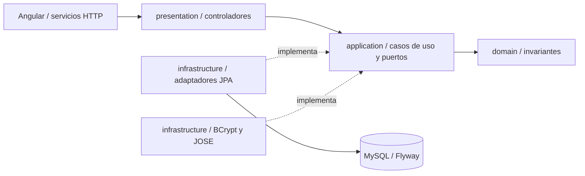

# Arquitectura — Incrementos 1 y 2

Backend modular Spring Boot 3.5.7, Java 17, paquete `pe.utp.entrevistapro360`; frontend Angular 21.2.0 con VIS-1.0. Se implementan los contratos de catálogo e identidad de los dos primeros incrementos.

## Cuatro capas

| Capa | Responsabilidad | Componentes reales |
| --- | --- | --- |
| `presentation` | HTTP, DTO públicos, estructura de solicitudes y errores JSON | `CatalogoController`, `AuthController`, `PerfilController`, DTO, `GlobalExceptionHandler`, `SecurityExceptionHandler` |
| `application` | Casos de uso y puertos independientes de frameworks | Servicios de catálogo, registro, autenticación y perfil; puertos de entrada/salida |
| `domain` | Modelos e invariantes puros | `Puesto`, `Pregunta`, `Usuario`, excepciones de validación y otros cinco modelos canónicos |
| `infrastructure` | JPA, BCrypt, JWT, seguridad y composición | Adaptadores/repositorios JPA, `BCryptPasswordHasher`, `JwtTokenProvider`, `JwtAuthenticationFilter`, configuraciones |

Dominio y aplicación solo importan Java y las capas internas permitidas. `LayerDependenciesTest` mantiene esta regla. Se inyecta `java.time.Clock` para obtener UTC sin depender de Spring en los casos de uso. Los controladores usan puertos de entrada y nunca acceden a JPA. La infraestructura implementa puertos y compone servicios; la serialización de errores permanece en presentación.

## Catálogo y persistencia

Se conservan los GET públicos del Incremento 1. El caso de uso busca un puesto activo y valida exactamente tres preguntas activas del mismo puesto, con órdenes 1, 2 y 3. Ausencia/inactividad produce 404; catálogo incompleto, 409. La semilla resuelve IDs por nombre único.

No se modifican V1/V2: ocho tablas y 68 columnas de negocio, InnoDB, `utf8mb4_unicode_ci`, JSON y acciones referenciales. `flyway_schema_history` es una tabla técnica adicional. Hibernate usa `ddl-auto=validate`; Flyway controla el esquema. Están activos los mapeos JPA de usuarios, puestos y preguntas. Los otros modelos no tienen operaciones de persistencia implementadas aún.

Las operaciones JPA son transaccionales en los adaptadores. Las pruebas MVC atraviesan seguridad, casos de uso y JPA reales, sin mocks del catálogo o identidad. H2 usa las mismas migraciones en modo MySQL; el perfil de pruebas `mysql` repite la integración y comprueba metadatos reales.

## Registro y acceso

`RegistrarUsuarioService` normaliza nombre/correo, valida contraseña, comprueba correo existente, calcula BCrypt y persiste. El dominio asigna POSTULANTE/ACTIVO, fecha UTC, actualización nula y resumen nulo. La restricción `uk_usuarios_email` resuelve también colisiones concurrentes: el adaptador la traduce a `EmailYaRegistradoException`, que produce 409. Se prueban el chequeo previo y una colisión SQL real.

`AutenticarUsuarioService` valida datos y compara el password exacto con BCrypt. Un usuario desconocido también realiza una comparación con hash ficticio. Contraseña incorrecta, usuario desconocido, cuenta inactiva o rol incompatible producen el mismo mensaje 401. No se promete bloqueo tras cinco intentos.

BCrypt usa costo 12 por defecto y en el perfil `prod`; las pruebas de integración usan costo 4. Una prueba separada verifica costo 12 y espacios. La contraseña nunca se recorta ni se normaliza silenciosamente. Se exigen al menos 12 puntos de código Unicode y como máximo 72 bytes UTF-8.

## JWT y autenticación por petición

`JwtTokenProvider` usa `NimbusJwtEncoder` con HS256. Incluye `iss=entrevista-pro-360`, `sub=id_usuario`, `rol=POSTULANTE`, `iat` y `exp=iat+1800`. `NimbusJwtDecoder` verifica firma/algoritmo; validadores comprueban issuer, timestamps, duración exacta y vencimiento sin tolerancia adicional.

En rutas privadas, `JwtAuthenticationFilter` toma el ID verificado y consulta la base en cada petición. Solo autentica si la cuenta existe, está ACTIVO y conserva rol POSTULANTE. Ausencia de token, firma/tiempo inválidos, cuenta eliminada/inactiva/bloqueada o rol incompatible producen 401 con `ApiError`. El contexto de seguridad contiene el ID; el perfil no usa IDs enviados por el cliente para seleccionar al propietario.

`JWT_SECRET` requiere al menos 32 bytes UTF-8. Si está vacío en local, se generan 32 bytes criptográficamente aleatorios por arranque, compartidos por encoder/decoder y nunca impresos. Reiniciar invalida esos tokens. El perfil `prod` impide la clave efímera y exige una variable válida. El fixture conocido de pruebas solo aparece en recursos de test.

La API es stateless, sin formulario de Spring, Basic ni usuario automático. CSRF está deshabilitado para la credencial explícita en Authorization, sin cookies de autenticación. Catálogo y `/auth/**` son públicos; el resto exige autenticación.

## Perfil y DTO

`GestionarPerfilService` consulta al propietario autenticado y construye un nuevo `Usuario` cambiando solo nombre, resumen y fecha de actualización. El adaptador modifica únicamente esas columnas. ID, correo, hash, rol, estado y fecha de registro se conservan.

Nombre: trim, 1..150. Correo: trim, minúsculas Locale.ROOT, formato válido y máximo 150. Resumen: trim, vacío a null, máximo 500 y texto plano. Jackson usa `SNAKE_CASE`, rechaza propiedades desconocidas y coerción de escalares. PATCH rechaza correo, rol, estado, hash, IDs y cualquier propiedad ajena al DTO. Las respuestas enumeran ocho propiedades públicas y nunca exponen el hash. Las fechas usan ISO 8601 con `Z` y DATETIME UTC con precisión de segundos.

Los errores mantienen `codigo`, `mensaje` y `errores_campo`. Los contratos HTTP se detallan en `api-catalogo.md` y `api-identidad.md`.

## Angular

Componentes standalone y rutas diferidas por funcionalidad. `AuthService` usa signals y mantiene token/usuario únicamente en memoria. Con `expires_in` programa limpieza y navegación a `/login`; guards e interceptor comprueban también vencimiento al actuar. Cerrar sesión elimina ambos datos y el temporizador. Recargar crea un estado no autenticado.

El interceptor agrega Bearer solo a rutas privadas de la API propia y limpia/redirige ante 401 privado. El 401 de login se muestra en su formulario. Una respuesta tardía anterior no restaura el usuario ni elimina una sesión posterior. Los guards protegen panel/perfil; login/registro redirigen al panel si existe sesión vigente.

La cabecera pública ofrece Puestos/Iniciar sesión/Crear cuenta; la autenticada, Panel/Puestos/Perfil/nombre/Cerrar sesión. Reactive Forms implementa validadores Unicode/UTF-8, confirmación exacta, errores de campo y estados de envío. El perfil tiene correo readonly, contador de resumen y avisos. El resumen se presenta como valor de formulario, sin `innerHTML`. VIS-1.0 conserva Arial, colores, foco y adaptación móvil.

Cerrar sesión no revoca un JWT copiado previamente: vence a los 30 minutos y el backend sigue comprobando la cuenta. No hay renovación automática ni tabla de sesiones de autenticación.

## Alcance siguiente

El panel permite explorar puestos y editar el perfil. Sesiones, grabación, multimedia, S3, STT, evaluación, resultados e historial continúan pendientes. JOSE tiene uso real; SDK S3 sigue reservado. No se presenta la disponibilidad de modelos externos como validada.
